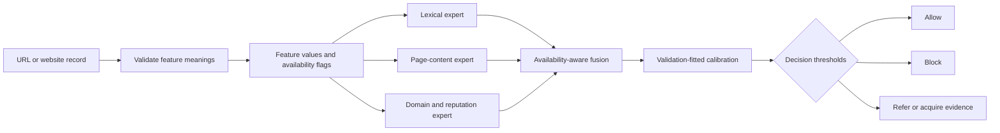
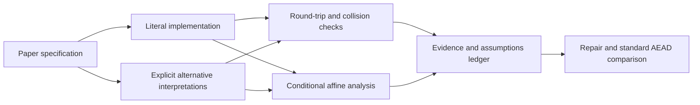
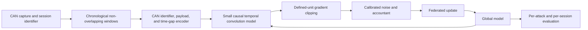
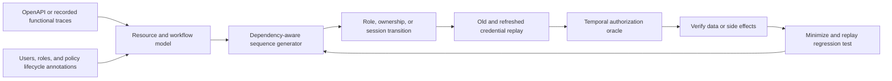
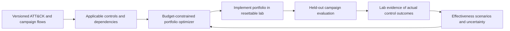
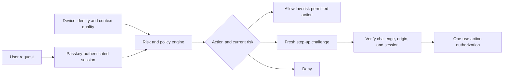
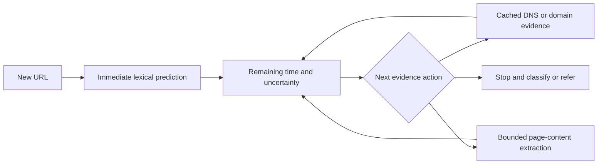
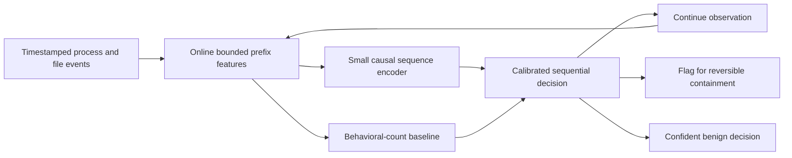

**Cybersecurity research extensions: architectures, experiments, and project selection**

Research checked on 1 November 2026. This covers the six main papers and two provisional IJICS candidates from our earlier discussion. P1–P8 below preserve that original order. The earlier Q4 qualification was historical 2024 SJR; this document does not make a new claim about current journal rankings.

**My recommendation:** choose P4, temporal authorization testing, for the strongest balance of a precise research question, measurable outcomes, and controllable data. Choose P1 if your project must center on machine learning. Give P2 a short feasibility investigation if you enjoy cryptography; commit to a full project only after resolving its specification ambiguities.

All architectures and experiments below are proposals. No improvement percentages, attack success rates, reproduced baseline scores, or publication probabilities have been established. A literature search can identify competing work; it cannot certify that an idea is novel. Six original full texts were accessible. For P7 and P8, the original publisher abstracts were accessible, but I could not inspect the complete papers through the available access. Their extensions remain provisional.

**Ranked choices**

| Rank | Base paper | Proposed project | Main reason to consider it | Main risk | First useful pilot |
|---|---|---|---|---|---|
| 1 | P4: automatic penetration-test generation | Test authorization after permissions, ownership, or sessions change | Clear security property; reproducible defect benchmarks; strong software artifact | Existing stateful testing and security oracles already cover part of the problem | Detect a revocation defect while accepting a correct delayed-revocation implementation |
| 2 | P1: multilayer CNN phishing detection | Phishing classification that handles missing and unreliable evidence explicitly | Public data and manageable compute; useful operational metrics | Crowded field; obtaining genuine feature availability/freshness data | Compare a missingness-aware model against CatBoost under held-out failure patterns |
| 3 | P2: graph-based biometric encryption | Correctness and conditional affine cryptanalysis, followed by an authenticated repair | Specific mathematical concerns; inexpensive initial investigation | Ambiguous specification; a simple modulo bug alone may be too small for a paper | Reconstruct a literal version and test all byte values plus fixed-key affine behavior |
| 4 | P5: MITRE mitigation ranking | Select portfolios using verified control effectiveness and uncertainty | Useful defensive decision problem; limited ML compute | Synthetic effectiveness assumptions can dominate the answer | Show a ranking reversal caused by a measured prerequisite or control failure |
| 5 | P3: federated learning with differential privacy | Compact temporal CAN detection with explicitly audited privacy accounting | Substantive privacy and deployment questions | Privacy mathematics, limited vehicle diversity, extensive competing work | Compare compact models at an identical, defensible privacy budget |
| 6 | P8: malware/ransomware behavioral feature selection | Early ransomware decisions under a false-intervention budget | Strong security impact; can improve the operational objective | Original full text and timestamped behavioral traces are unresolved dependencies | Establish that real prefixes and benign lookalikes are available |
| 7 | P7: real-time zero-day phishing | Deadline-aware acquisition of fresh phishing evidence | Clear latency/accuracy tradeoff | Substantial overlap with P1 and existing cascades; full text unavailable | Measure complete acquisition latency, including failed lookups |
| 8 | P6: smart-home authentication | Cryptographic authentication plus spoof-resistant adaptive step-up | Clear security engineering value | A credible user/context dataset and precise original protocol are difficult to obtain | Demonstrate that spoofed context cannot replace cryptographic proof |

These are judgments about project suitability, not statistical scores. Ranks 1–4 are the strongest starting shortlist. Ranks 5–8 become more attractive when the necessary expertise or data are already available.

**What counts as a convincing improvement**

Compare methods on the same held-out data, available inputs, tuning budget, and operational constraint. Keep two separate tracks when inputs or splits change: reproduction of the original setup, and a stronger external evaluation. A lower accuracy on a harder test cannot be compared numerically with the original headline score as though it were the same experiment.

Use current competitors as well as the old base paper. Freeze test sets and select thresholds on validation data. For ML, use several seeds where stochastic training matters and calculate uncertainty over independent domains, sessions, families, or applications. Thousands of correlated rows do not constitute thousands of independent experiments. Report confidence intervals and negative findings. For extremely low false-positive claims, ensure sufficient benign observations: with zero errors, the approximate 95% upper bound is 3/N only when the underlying trials are suitably independent.

For unavailable original code, identify a baseline as a reimplementation and enumerate missing settings. Do not fill undocumented details with favorable assumptions and call the result a reproduction.

---

**P1. Phishing Website Detection Using Improved Multilayered Convolutional Neural Networks**

Hadia Bibi et al., Journal of Computer Science, 2024, 20(9), 1069–1079. [Original paper](https://thescipub.com/pdf/jcssp.2024.1069.1079.pdf).

**Evidence from the base paper.** The study uses a 30-feature UCI dataset and a 70/30 split. The preprocessing text describes treating `-1` as missing and mentions SMOTE before the split description. These warrant investigation; prose ordering does not prove leakage in the executed code. UCI identifies the dataset as having no missing values. [Original methods, p. 1072](https://thescipub.com/pdf/jcssp.2024.1069.1079.pdf); [UCI dataset documentation](https://archive.ics.uci.edu/dataset/327/phishing%2Bwebsites).

**Proposed research question:** can explicit evidence quality reduce missed phishing at a fixed false-positive and referral budget when feature sources fail or change?

**Architecture.** Start with a small model rather than committing immediately to a transformer:

1. Keep valid categorical states such as `-1`, `0`, and `1` distinct. Use a separate missing token. Distinguish unavailable, timed out, and invalid values when the extraction system can actually identify those states.
2. Train experts on meaningful groups of features. A lexical expert can operate when page content or reputation lookups are unavailable. Use small MLPs or tree models as the initial implementation.
3. Fit a gating function from available experts and quality flags. Normalize weights across available experts. Include feature age only if collection timestamps exist; otherwise label age-based experiments as simulations.
4. Train with whole-group dropout, representing plausible source failures. Do not simulate only independent random cell deletion. Hold out some failure mechanisms to test robustness to a new outage pattern.
5. Fit calibration and allow/block/referral thresholds on validation data. Report the number and class composition of referred samples; a model cannot claim improved full-population detection by silently excluding hard cases.

**Why this might improve results.** The intended gain is robustness under evidence failures and lower operational error at a specified coverage, not a presumed increase beyond the paper's reported 99.1%. The original feature table supports a controlled reproduction track. A separate raw-URL track is needed for domain-grouped evaluation: raw URL identities needed for that grouping are not supplied by the legacy 30-feature table itself.

**Data plan.** Use UCI for reproduction. For external work, inspect [PhiUSIIL](https://archive.ics.uci.edu/dataset/967/phiusiil%2Bphishing%2Burl%2Bdataset) and [PhishVN](https://github.com/vuthainguyen1602/phishvn). Re-extract a common feature schema where possible. Never train on one schema and claim direct transfer to an incompatible one. PhishVN documents mixed timestamp provenance, so audit which records support chronological conclusions. A dataset release date is not an individual URL's event time. [PhishVN paper](https://doi.org/10.1016/j.dib.2026.113195).

**Competitors and novelty boundary.** A [2025 preprint already proposes dual-branch TCNs with mask attention for missing features](https://papers.ssrn.com/sol3/papers.cfm?abstract_id=5099406). A [2026 paper already studies calibrated selective cascades for phishing emails](https://www.mdpi.com/2079-9292/15/14/3051). Missingness, ensembles, or abstention alone are therefore insufficient novelty claims. The candidate contribution is a controlled study and method for source-dependent evidence failures, with matched referral budgets and external validation.

**Experiments.** Compare the original-style CNN, regularized logistic regression, CatBoost, a single small neural model with missing indicators, the expert model without quality gating, and the complete model. Evaluate full evidence, group outages, invalid inputs, and genuine freshness shifts when timestamps support them. Ablate group dropout, quality flags, and calibration individually. Primary metric: phishing recall at a fixed false-positive rate and fixed referral coverage. Secondary metrics: PR-AUC, calibration, worst-scenario recall, model size, and extraction-plus-inference latency.

**Early decision.** Continue if the advantage survives strong missingness-aware tree baselines and a held-out outage/domain condition. If the benefit appears only against the old CNN, reconsider the contribution.

---

**P2. Irregular Reflexive Labeling and Elementary Row Operations for Enhanced Biometric Image Encryption**

Ika Hesti Agustin et al., Journal of Computer Science, 2024, 20(12), 1766–1777. [Original paper](https://thescipub.com/pdf/jcssp.2024.1766.1777.pdf).

**Evidence from the base paper.** Algorithm 2 combines row operations and an additive key matrix modulo 255. The methods also describe reducing image values modulo 255. [Original methods and Algorithm 2, pp. 1768 and 1771](https://thescipub.com/pdf/jcssp.2024.1766.1777.pdf).

**Proposed project:** establish the scheme's exact input domain, reversibility, and fixed-key security before proposing a repair.

There are two different deductions to investigate:

1. **Correctness:** reducing unrestricted 8-bit pixel values modulo 255 maps both 0 and 255 to 0. If that reduction occurs without separately preserving the lost distinction, exact decryption of arbitrary 8-bit images is impossible. This follows mathematically from the described reduction; it has not been tested against the authors' implementation.
2. **Conditional affine analysis:** if the row operations are linear, fixed for a key/image size, and independent of plaintext, the resulting vectorized map has the form `C = A P + b mod 255`. Then an encryption of the zero vector yields `b`, and encryptions of basis vectors reveal columns of `A`. For N input components, at most N+1 such chosen inputs identify this affine mapping. Recovering the mapping does not require recovering the secret key. The conclusion is conditional: plaintext-dependent operations, additional nonlinear processing, or an unavailable implementation could invalidate that model.

**Architecture for the investigation.**

First document ambiguous row selection, multipliers, key generation, square-image handling, and decryption. Use synthetic all-zero, all-255, ramp, and impulse images before real biometric images. Validate any recovered equivalent mapping on unseen images of the same dimensions. Report query count, recovery complexity, applicability conditions, and exact byte recovery.

**Repair.** Serialize image bytes losslessly and use a standard authenticated-encryption construction with properly managed nonces and authenticated format metadata. Compare [AES-GCM](https://csrc.nist.gov/pubs/sp/800/38/d/final) and [ChaCha20-Poly1305](https://www.rfc-editor.org/rfc/rfc8439). A graph transform could remain as an optional reversible preprocessing experiment, but security should not depend on an unsupported claim that it strengthens AEAD. Changing 255 to 256 alone does not fix an affine cipher, and arbitrary row multiplication need not be invertible modulo 256.

**What would be new enough to pursue?** The strongest result would characterize the affected class of graph/row-operation constructions, demonstrate equivalent-map recovery under explicit assumptions, and evaluate a correction. Affine and chosen-plaintext cryptanalysis are established techniques: [an earlier image-cipher analysis](https://zhoukanglei.github.io/publications/cryptanalysis_mhm/Cryptanalysis_MHM.pdf) is relevant background. I did not locate a direct cryptanalysis of this exact 2024 paper in the targeted search, which is not proof that none exists.

**Early decision.** Allocate a short pilot. Continue only if the original scheme is specified well enough to support a faithful implementation or a precise theorem about the published construction. A modulo typo plus an ordinary AES wrapper may be suitable for a technical note but insufficient for the larger research paper you want.

---

**P3. Enhancing IoT Security: A Novel Approach with Federated Learning and Differential Privacy Integration**

Aziz Ullah Karimy and P. Chandrasekhar Reddy, IJCNC, 2024, 16(4), 1–17. [Original paper](https://aircconline.com/ijcnc/V16N4/16424cnc01.pdf).

**Evidence from the base paper.** The cybersecurity experiment converts Car-Hacking records into images, uses an IID client allocation, and reports privacy parameters. Algorithm 3 describes adding noise before clipping. That is a reason to audit the stated mechanism and accounting, not sufficient evidence to declare every implementation non-private. [Original experimental setup and Algorithm 3](https://aircconline.com/ijcnc/V16N4/16424cnc01.pdf).

**Proposed research question:** at a matched, correctly accounted privacy budget, can a compact temporal CAN model preserve attack coverage more efficiently than image-based federated training?

**Architecture.**

Use bounded windows, for example 32 or 64 messages, as candidate lengths. Encode identifiers, byte payloads, and interarrival times without turning each row into a large artificial image. Keep windows within sessions and use a purge gap across chronological splits. Use a causal model whose prediction never sees later messages. Compare cross-entropy and a fixed focal-loss variant, avoiding privately computed adaptive class statistics unless their disclosure and privacy costs are addressed.

**Privacy design is a central part of the project.** State whether adjacency changes one message, one window, one trip, or one client. These offer different guarantees. A per-window DP-SGD implementation must not be advertised as trip-level or client-level DP. Non-overlapping windows do not automatically remove correlations or protect the whole person's trajectory. Account for repeated steps and releases across all federation rounds, sampling assumptions, and any public calibration data. [DP-SGD's original construction](https://arxiv.org/pdf/1607.00133) and [Opacus documentation](https://opacus.ai/tutorials/intro_to_advanced_features) provide implementation references; a library does not supply a missing threat model or change the privacy unit by itself.

**Data plan.** Use [HCRL Car-Hacking](https://ocslab.hksecurity.net/Datasets/car-hacking-dataset) for baseline compatibility and [ROAD](https://zenodo.org/records/10462796) for a separate evaluation. ROAD is a single-vehicle dataset, so partitioning its captures into clients is a simulation, not evidence of a real multi-vehicle federation. Avoid raw CAN-ID transfer assumptions across different vehicles; either justify a common representation or report separate experiments.

**Competitors and novelty boundary.** Federated personalization, DP, and non-IID IDS already appear together in [SFLNID, 2025](https://ieeexplore.ieee.org/document/11089949/). A [September 2026 preprint](https://arxiv.org/abs/2609.03420) already investigates privacy, robust aggregation, and rare-attack coverage jointly. Thus, combining these ingredients is not a credible novelty claim. The plausible contribution is a CAN-specific efficiency/privacy benchmark and a demonstrated design improvement under a precise privacy unit. Do not add poisoning resistance or secure aggregation merely to make the diagram larger; those introduce additional assumptions and compatibility questions.

**Experiments.** Compare centralized and federated non-private models, the original-style image model, a compact MLP, the temporal model, and privacy-matched versions. Use capture/time-based client partitions alongside labeled Dirichlet simulations. Report recall for every attack category, macro-F1, low-FPR performance, worst-session performance, final epsilon/delta, communication bytes, memory, and CPU inference latency. Keep distinct records of nominal requested privacy and actually composed privacy. Do not tune on the final test sessions.

**Early decision.** Continue if a correctly accounted compact model improves the utility/resource tradeoff and the available sessions support meaningful independent evaluation. Reconsider if only IID random splits produce the benefit.

---

**P4. Design and Development of an Automatic Penetration Test Generation Methodology for Security of Web Applications**

Shilpa R. G., Pushphavathi T. P., and Murthy P. V. R., Journal of Computer Science, 2024, 20(10), 1176–1184. [Original paper](https://thescipub.com/pdf/jcssp.2024.1176.1184.pdf).

**Evidence from the base paper.** The paper explicitly limits each generated penetration-test scenario to one penetration-test event, and demonstrates length-1 vulnerability coverage. [Original paper, pp. 1181–1183](https://thescipub.com/pdf/jcssp.2024.1176.1184.pdf).

**Recommended project:** generate tests for authorization that becomes stale after a permitted state change.

Example target property: a user can access a shared resource; its owner revokes sharing; after the application's documented propagation grace period, the former recipient's existing session must no longer read or modify that resource. Similar cases include role downgrade, ownership transfer, tenant changes, logout, and resource deletion. The novelty candidate is precise temporal security oracles and efficient generation of their preconditions.

**Architecture.**

1. Model a state as principal, resource identity, ownership/sharing state, session/token generation, and relevant policy version. Start with explicit annotations for security-changing endpoints; do not assume the tool can infer every business policy from OpenAPI.
2. Reuse an existing fuzzer's resource dependency and request-generation machinery. Add transitions such as grant/revoke/downgrade, preserving the resource and original credentials.
3. Generate paired checks with old and refreshed credentials before and after the transition. Keep a legitimate control principal to distinguish authorization denial from a broken service or deleted fixture.
4. Define the application's expected revocation bound. An intentionally valid token or documented eventual-consistency delay must not automatically become a vulnerability. Mark missing policy information as inconclusive.
5. Verify resource data or actual state changes. A 200 response alone is not evidence of unauthorized access, and a 403 alone is not proof that the write did not occur.
6. Minimize failing sequences and replay from clean application state. Preserve roles, generated IDs, timing, and dependency constraints during minimization.

**Why it could improve results.** It expands the class of defects reachable from the original length-1 method and produces replayable evidence. The primary gain is additional confirmed temporal authorization defects per request budget, not a classification-accuracy number.

**Competitors and novelty boundary.** Stateful sequences already exist in [RESTler](https://github.com/microsoft/restler-fuzzer). The [April 2026 EvoMaster security-oracle preprint](https://arxiv.org/html/2604.00702v1) already covers several authorization and injection checks. Therefore, neither statefulness nor generic BOLA checks alone are new. Its described authorization oracles emphasize cross-operation consistency; the candidate extension here is lifecycle transitions with explicit freshness and revocation semantics. This boundary must still be checked against the complete current tools and literature.

**Benchmark plan.** Select locally runnable open-source applications from the [Web Fuzzing Dataset](https://github.com/WebFuzzing/Dataset) that actually expose the needed lifecycle. Add a small, separately reported benchmark of manually reviewed mutations: missed token invalidation, stale permission caches, or incomplete sharing revocation. Include correct controls with legitimate sharing and delayed revocation. Keep synthetic mutations separate from natural defects and deduplicate multiple traces of one root cause. A test-only administrative fixture does not count as a discovered public endpoint; disclose any reset/annotation advantage given to each tool.

**Experiments.** Compare the base length-1 generator, RESTler, current EvoMaster security oracles, a generic multi-event generator, and the proposed lifecycle scheduler. Match reset privileges, supplied role information, request count, and wall-clock budgets. Ablate lifecycle state, temporal bounds, principal pairing, side-effect checks, and minimization separately. Metrics: confirmed unique defects, mutation recall, false alarms on correct implementations, time to first confirmed defect, requests per defect, and reproducibility across reruns. Evaluate across applications, not just repeated runs of one application.

**Early decision.** In an initial pilot, demonstrate three things: a defect requiring a genuine permission change; a correct implementation the oracle accepts; and an advantage over a current generic security oracle under matched information. If annotations effectively encode the full bug-triggering script, redesign the automation claim.

---

**P5. Enhancing Cybersecurity Defenses: A Multicriteria Decision-Making Approach to MITRE ATT&CK Mitigation Strategy**

Ihab Mohamed, Hesham A. Hefny, and Nagy R. Darwish, IJCNC, 2024, 16(4), 19–35. [Original paper](https://aircconline.com/ijcnc/V16N4/16424cnc02.pdf).

**Evidence from the base paper.** Its worked formulation uses the top ten techniques and eighteen mitigation controls, with equal within-technique control priorities. The illustrative emulation focuses on a small Windows environment. [Original formulation and experiment](https://aircconline.com/ijcnc/V16N4/16424cnc02.pdf).

**Proposed research question:** can measured, configuration-dependent control effectiveness produce more reliable mitigation portfolios under the same budget than a static weighted ranking?

**Architecture.**

Use [MITRE Attack Flow](https://ctid.mitre.org/projects/attack-flow/) for explicitly represented sequences. An ATT&CK tactic ordering alone is not a validated attack path. Map abstract mitigations to concrete configurations and prerequisites. Keep detection, prevention, and recovery separate.

For a selected control set z and a scenario s, define campaign loss from measured or explicitly simulated goal outcomes. Optimize the worst scenario or a declared risk measure over an uncertainty set, subject to deployment cost, staff time, prerequisite, and compatibility constraints. With an initial eighteen controls, exhaustive or small-scale exact optimization can validate the optimizer. A complicated RL method is unnecessary unless sequential decisions and enough evidence justify it.

**Candidate contribution.** The useful addition is an evidence-driven loop that measures when controls fail, including prerequisite and interaction failures, and uses those observations to choose robust portfolios. ATT&CK's `mitigates` relationship must not be turned automatically into a numerical probability of blocking an attack. Likewise, multiplying independent blocking probabilities is unjustified when controls share a prerequisite.

**Competitors and novelty boundary.** A [2026 Future Generation Computer Systems paper already studies dynamic characterization and mitigation-selection optimization](https://doi.org/10.1016/j.future.2025.108272), and [budget-constrained mitigation using reinforcement learning has also been published](https://www.mdpi.com/1424-8220/26/1/21). Merely adding costs, attack graphs, or an optimizer would overlap strongly. Emphasize experimentally verified implementation conditions and robust performance on held-out campaigns.

**Experiments.** Compare the original ranking under a budget, prevalence-weighted greedy selection, maximum-coverage/knapsack, a point-estimate optimizer, and the uncertainty-aware method. Match available controls and costs. Vary campaign mix, one failed prerequisite, stale evidence, and deployment budget. Report attack goals prevented, actual deployment effort, residual campaign loss, and regret relative to the best feasible portfolio for each test scenario. Technique-count coverage is a secondary surrogate. Estimate uncertainty from lab reruns and scenario variation without representing it as universal real-world probability.

**Early decision.** Continue if measured dependencies or uncertain effectiveness change which portfolio works best, and the advantage persists beyond the campaign used to fit the model. If the study only optimizes a hand-invented matrix, keep it as a simulation study and lower the claimed practical impact.

---

**P6. Secure Supervised Learning-Based Smart Home Authentication Framework**

K. Swapna Sudha, N. Jeyanthi, and Celestine Iwendi, IJCNC, 2024, 16(1), 1–12. [Original paper](https://aircconline.com/ijcnc/V16N1/16124cnc01.pdf).

**Evidence from the base paper.** The framework uses contextual information; its security comparison includes qualitative strength labels. A precise message-level baseline and measurable security outcomes would be needed for a fair extension. [Original framework and evaluation](https://aircconline.com/ijcnc/V16N1/16124cnc01.pdf).

**Proposed research question:** can adaptive context reduce authentication friction while preventing spoofed context from granting authority?

**Architecture.**

Use cryptographic device identity for gateway/device communication and a passkey or another established user credential for user authentication. Context affects the need for additional authentication, never replaces basic proof. Evaluate IP/Bluetooth location, access history, and time as fallible signals, with availability and trust-level indicators.

For sensitive operations, issue a fresh server challenge, store its binding to the expected action/session, and consume it once. Follow [WebAuthn's challenge and origin verification requirements](https://www.w3.org/TR/webauthn-3/). Binding a server-side challenge to an action does not, by itself, prove user intent on a compromised browser or provide a trusted display of the action.

Train a small calibrated risk model on legitimate and simulated attacker-context observations, then use risk tiers for step-up and denial. An attacker copying a trusted IP or replaying context should not bypass credential checks. Minimize retained context: derive coarse local features rather than storing raw location or calendar contents when those details are unnecessary.

**Competitors and novelty boundary.** [MRAAC](https://doi.org/10.1145/3648372) already studies multistage risk-aware adaptive authentication, and [CLAF-IoT](https://ieeexplore.ieee.org/abstract/document/10990157/) uses contextual adaptive authentication in IoT. Passkeys plus a risk score are established engineering choices. A plausible research contribution requires a defined context-spoofing threat model, explicit verification, and a measured security/usability advantage.

**Experiments.** Compare static authentication, fixed step-up rules, a risk model that ignores quality, and the full design. Hold out users and, where available, households. Measure false acceptance, false rejection, prompts per legitimate action, latency, and retained context volume. Specify the adversary's stolen credentials, device keys, and context access separately. Formal verification can address a defined cryptographic protocol model; it does not prove the learned context classifier's accuracy. Simulated households alone cannot establish real usability.

**Early decision.** Pursue this if you can obtain a credible context dataset or run a consented study and reconstruct the original baseline. Otherwise it is a sound implementation project with a weaker research path.

---

**P7. AI-driven approach for robust real-time detection of zero-day phishing websites**

Thomas Nagunwa, IJICS, 2024, 23(1), 79–118. [Publisher record](https://www.inderscience.com/info/inarticle.php?artid=136735).

**Evidence boundary.** The accessible abstract reports CatBoost performance and runtime measurement. It does not establish the complete feature acquisition or chronological test protocol. This proposal must be checked against the full text before calling any component an omitted evaluation. [Publisher abstract](https://www.inderscience.com/info/inarticle.php?artid=136735).

**Proposed research question:** which evidence should a real-time detector acquire before a deadline, given uncertain retrieval times and uncertain feature value?

**Architecture.**

Reuse a strong calibrated classifier, including CatBoost. Estimate the incremental value of each evidence group and its latency distribution from training/validation traces. Select an action only if its expected decision benefit justifies cost within the remaining budget. Begin with a simple greedy scheduler; introduce a learned policy only if it beats fixed thresholds and fixed stage orders.

Track observation time, source, retrieval error, and cache age. Never use a URL's later blacklist membership or future reputation as though it was known when the decision was made. Set a hard request deadline and include timeouts and unavailable pages in the outcomes. Parallel queries can be compared with sequential acquisition, but total external requests and p95/p99 latency must be counted.

**Competitors and novelty boundary.** Selective cascades already exist in [2026 phishing-email work](https://www.mdpi.com/2079-9292/15/14/3051), and [adaptive drift-aware URL learning](https://doi.org/10.1002/spy2.70057) is established recent work. The candidate contribution is an end-to-end evidence acquisition policy evaluated with actual acquisition traces and time-valid features, not another CatBoost ensemble.

**Experiments.** Compare URL-only, acquire-all, fixed cascade, parallel acquire-all, uncertainty-threshold escalation, and deadline-aware scheduling. Vary declared latency budgets and lookup failures. Report phishing recall at fixed FPR, completed-decision coverage, referrals, total requests, and tail latency. Chronologically hold out new domains/campaigns where trustworthy timestamps exist. A static CSV can support classifier experiments; it cannot establish live feature acquisition latency or first-seen detection.

**Early decision.** First inspect the original full text and obtain recorded acquisition timings. Consider combining this with P1 as one scoped phishing project, with P1 focusing on evidence reliability and P7 on acquisition scheduling. They should not be presented as two unrelated novel systems built from the same experiments.

---

**P8. Behavioural analysis and results of malware and ransomware using optimal behavioural feature set**

Laxmi B. Bhagwat and Balaji M. Patil, IJICS, 2024, 23(1), 57–78. [Publisher record](https://www.inderscience.com/info/inarticle.php?artid=136719).

**Evidence boundary.** The accessible abstract describes behavioral feature selection and classifier accuracy. It does not let me establish the full observation window, sample-family split, or time-to-intervention evaluation. The suggested extension is a research direction, not an assertion that those evaluations are absent. [Publisher abstract](https://www.inderscience.com/info/inarticle.php?artid=136719).

**Proposed research question:** can a detector intervene earlier on unseen ransomware families while keeping disruption of benign file-intensive applications below a declared budget?

**Architecture, conditional on timestamped traces.**

Encode event categories, timing, file-operation patterns, and process relationships available up to the decision time. Compare a small GRU/TCN with incremental counts and XGBoost before choosing complexity. Train on real prefixes and add a decision objective balancing missed ransomware, false containment, and the cost of waiting. Require each label and feature to reflect what was observable at that prefix.

Include benign compression, backup, encryption utilities, installers, and bulk file operations as hard negatives. Hold out whole ransomware families and newer capture periods. Do not split prefixes of the same executable between training and test. Measure delay from execution and, where instrumented ground truth exists, files/bytes irreversibly changed before intervention. Repeated prefix testing also creates multiple opportunities for false alarms; count false interventions per benign run rather than only per prefix.

**Data limitation that affects selection.** [MLRan's public release](https://zenodo.org/records/23403681) supplies processed behavioral feature groups and temporal sample splits. [Its repository](https://github.com/faithfulco/mlran) supports classification and feature-selection experiments, but the inspected release does not by itself supply verified timestamped event prefixes. You cannot turn final aggregate feature counts into genuine early observations. If event traces cannot be obtained, narrow this to family/temporal generalization with feature-group budgets and drop every claim about early stopping or pre-encryption detection.

**Competitors and novelty boundary.** [DEFEAT, revised October 2026 and accepted to ACSAC 2026](https://arxiv.org/abs/2609.21426), already reconstructs fragmented file-operation context for early ransomware detection. Earlier and contemporary approaches also study prefix/API sequences. Consequently, simply adding an LSTM or a file-event graph is insufficient. A more defensible contribution would demonstrate better generalization and lower false containment on challenging benign workloads at the same intervention delay, or lower damage at the same false-intervention budget.

**Experiments.** Compare the original feature-selection concept under matched data, prefix counts with XGBoost, a standard sequence model, and the sequential decision policy. Ablate timing, process relationships, the stopping objective, and hard negatives. Early-stage percentages are not comparable across samples unless trace completion is treated carefully: an online detector does not know the future length of an execution. Use absolute time/event-count checkpoints as well as any descriptive percentage plots.

**Early decision.** Verify data availability before selecting this project. Without real time-ordered observations and a legitimate-workload evaluation set, choose a different main project.

---

**Recommended execution path**

For one main project, select P4. A useful working title is **“Temporal Authorization Testing Through Policy-Lifecycle State Models.”** This is a proposed title, not a claim of first discovery.

The minimum credible artifact is a resettable lab application, an explicit lifecycle policy, a model of users/resources/sessions, generation of before/after sequences, side-effect-aware oracles, and minimized regression tests. The experimental contribution is a controlled benchmark showing what those oracles detect beyond current tools, at equal budgets and with known legitimate sharing behavior.

Use the first two weeks as a decision period, assuming you are already comfortable with Python, HTTP, Docker, and test automation:

| Work period | Deliverable | Decision |
|---|---|---|
| First few days | Inspect P4 and current EvoMaster/RESTler behavior; specify one lifecycle and its grace period | Stop claiming generic statefulness as novelty |
| Remainder of week 1 | One correct application and one reviewed stale-authorization defect; replayable setup | Verify the defect is about policy change, not an ordinary missing check |
| Week 2 | Minimal generator and oracle; comparisons with current tools under equal supplied information | Continue only if the contribution remains clear |
| Following phase | Multiple applications/lifecycles, ablations, independent repeats, natural defects where available | Judge generalization and precision before expanding scope |

A full project may take roughly 8–12 weeks for an experienced researcher, and longer when baseline reproduction or application setup is difficult. This is a planning estimate, not a promise.

If you prefer ML, select P1 and write the central claim around evidence reliability at a fixed error/referral budget. If you prefer mathematics, give P2 a short pilot and use an explicit assumptions ledger. Avoid starting several of these projects at once: the strongest submission will come from one defensible question, competitive baselines, and a reproducible artifact.
