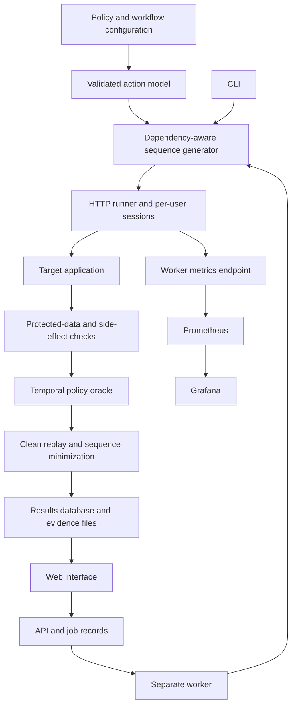

**Implementation plan: temporal authorization testing**

This is the original pre-implementation plan. Current completed work and remaining scope are tracked in [implementation status](docs/implementation-status.md).

Prepared 1 November 2026, before implementation. At the time of writing, the software and experimental results did not yet exist. The schedules and future-tense stages below are preserved as the original proposal; they are not the current implementation status. Estimated effort: 8–10 focused working weeks for one developer comfortable with Python. Part-time work and unfamiliar target applications will take longer. The first useful prototype should arrive in approximately three working weeks.

**1. Project objective and research boundary**

Build a tool that checks whether access changes take effect correctly after sharing revocation, role downgrade or ownership transfer. It must preserve the original user session, execute a valid workflow, respect the application's stated propagation delay, verify protected data or actual changes, and produce a replayable finding.

Example: Alice shares a document with Bob. Bob reads it using session T1. Alice revokes his access. The application's policy permits a five-second propagation delay. A request started after that deadline still returns the protected content to T1, while Alice can still access the document. This is a candidate violation, subject to clean replay and the declared policy.

The research question is whether explicit lifecycle state and temporal checks find more confirmed unique authorization defects, with an acceptable false-alarm rate, than comparable testing strategies under matched budgets. There is no established improvement percentage.

The base paper already models functional sequences; our contribution cannot simply be “multi-step testing.” Its illustrated method limits a penetration scenario to one penetration-test event. RESTler is already stateful, and the April 2026 EvoMaster preprint includes access-policy oracles. Our candidate contribution is lifecycle-specific generation, timing-aware verification and evidence. Validate this boundary before investing in the interface. [Base paper, pp. 1181–1183](https://thescipub.com/pdf/jcssp.2024.1176.1184.pdf), [RESTler](https://github.com/microsoft/restler-fuzzer), [EvoMaster preprint](https://arxiv.org/abs/2604.00702).

**2. Scope of the first release**

| First working prototype | Research release | Later extensions |
|---|---|---|
| Annotated REST workflow; one document-sharing lab | Revocation, role downgrade and ownership transfer where policy supports them | Tenant changes, session logout/invalidation, token refresh and browser-only workflows |
| Bearer-token login; separate users and saved old/new sessions | Adapters for at least two independent existing application codebases, subject to feasibility | Broad automatic application discovery |
| Read-access verification and declared grace period | Protected-write verification, dependency-aware generation, replay and minimization | More sophisticated search algorithms |
| CLI, SQLite results, JSON evidence | Small web interface; optional Prometheus/Grafana profile | Multiple workers and remote deployment |

OpenAPI describes requests and schemas; we will supply a small policy/workflow configuration for actor roles, security-changing operations and expected outcomes. Fully automatic inference of business authorization policy is outside this release.

Use locally runnable applications or environments supplied for testing. A normal development laptop should support the initial prototype; no GPU is needed. Measure resource requirements before running multiple benchmark applications together.

**3. Chosen implementation stack**

| Layer | Choice | Reason |
|---|---|---|
| Core and CLI | Python, HTTPX, Pydantic, Typer | One reusable execution library, isolated HTTP sessions and validated configuration |
| Workflow model | Explicit action/dependency graph in Python; NetworkX only if graph operations justify it | Keep the first generator understandable and reproducible |
| Evidence and jobs | SQLite through SQLAlchemy; JSON artifacts | Simple local deployment with structured, queryable records |
| API and interface | FastAPI, Jinja2 templates and HTMX | Small configuration/findings interface without a separate frontend build |
| Execution service | Separate Python worker process; one active run initially | Tests survive browser navigation and stay separate from web requests |
| Demonstration target | Separate FastAPI document-sharing application and isolated database | Controlled correct and defective variants with known policies |
| Verification | pytest, real HTTP integration tests, Docker Compose | Validate the security oracle and complete workflows |
| Monitoring | prometheus-client, Prometheus, Grafana | Optional numerical monitoring, added after the core works |
| Research analysis | CSV/JSON exports, pandas and Matplotlib | Reproduce paper tables and figures from raw experiment records |

Pin exact library versions and container digests after the first compatibility smoke test. Keep the tool database separate from every target application's database. A larger queueing system is unnecessary for one worker; reconsider only if parallel execution becomes a requirement. FastAPI documents background tasks, but this design uses a separate worker for long experiments and explicit run state. [FastAPI documentation](https://fastapi.tiangolo.com/tutorial/background-tasks/).

**4. Component architecture**



The CLI and worker call the same core library. The website submits jobs and displays stored results. Grafana provides aggregate monitoring; detailed evidence and replay remain in our application. The temporal oracle uses engine timestamps and responses, independently of monitoring scrape intervals.

**5. Milestones and acceptance gates**

| Stage | Estimate | Work and deliverable | Gate before proceeding |
|---|---|---|---|
| 0. Research and policy specification | 2 days | Check current competing implementations; define supported policies, inputs, metrics and baseline capabilities | Identify a defensible lifecycle/timing distinction; document overlap and stop or narrow the claim if already covered |
| 1. Controlled target application | 4 days | Login, document creation, grant/revoke, protected read, target reset; correct immediate, correct delayed and stale-session variants | Independent tests establish each variant's actual behavior and declared policy |
| 2. Runner and CLI | 5 days | Validated configuration, isolated sessions, dynamic ID binding, budgets, timestamps and JSON evidence | Complete the grant/read/revoke/retry workflow from a clean state without hard-coded document IDs |
| 3. Temporal oracle and replay | 5 days | Protected-content checks, deadline handling, legitimate controls and clean replay | Detect the stale-session variant; accept correct immediate and bounded-delay variants; classify missing policy or unhealthy controls as inconclusive |
| 4. Generalized generation and write checks | 7 days | Role/ownership state, dependency-aware generation, old/fresh credentials, protected-write readback, minimization | Generate several valid lifecycle sequences and preserve their dependencies during replay/minimization |
| 5. Existing applications and baselines | 5 days | Screen external applications; build adapters and run P4-style, generic sequence and modern-tool comparisons | At least one independent existing application works end to end; aim for two; document every required annotation and privilege |
| 6. Small web interface | 4 days | Configuration, runs, progress, findings, evidence and replay download | An experiment can be submitted and reviewed through the browser; cancelling stops further test requests after the current request resolves or times out |
| 7. Optional monitoring | 2 days | Worker metrics, provisioned Prometheus/Grafana configuration and one dashboard | Metrics match stored run records in a smoke test; project runs normally with monitoring disabled |
| 8. Frozen evaluation | 6 active days plus unattended runs | Final baselines, ablations, repeated runs, analysis and limitations | Results trace to raw evidence; reviewed defects are deduplicated; failures and inconclusive cases remain visible |
| 9. Reproducible release | 2 days | Setup instructions, pinned environment, benchmark manifest, sample report and demo | A clean local checkout can execute the documented sample experiment and reproduce its expected finding |

These are planning estimates, not deadlines. If external application support slips, defer interface polish and additional lifecycle types before reducing oracle verification or fair comparisons.

**6. First prototype: the exact demonstration**

Use Alice as owner and Bob as recipient. Each run creates a fresh document containing a random protected marker.

1. Reset the target and create the two users.
2. Alice creates the document and grants Bob access.
3. Bob authenticates, preserves session T1, and reads the protected marker successfully.
4. Alice revokes access. Record the transition request's send and completion times and any available effective-time signal.
5. Wait until a policy-valid check can be made. For the lab, define the maximum delay relative to successful revocation acknowledgement.
6. Send a read using T1 after the deadline, then compare with a fresh Bob session T2 where supported.
7. Verify Alice still sees the same resource and protected marker.
8. Evaluate the returned content, save evidence, and replay a suspected violation from a clean initial state.

| Target variant | Declared behavior | Expected tool verdict |
|---|---|---|
| Correct immediate enforcement | Bob loses access as soon as revocation is acknowledged | No violation observed |
| Correct bounded delay | Access may persist for up to five seconds after acknowledgement | No violation for access inside the grace period; deny on checks after the bound |
| Stale session defect | Bob's old session retains revoked access beyond the five-second bound | Confirmed violation after protected-content verification and clean replay |
| Unknown policy or failed revocation | No usable bound, or transition did not complete | Inconclusive or invalid setup |
| Target unavailable | Owner control cannot verify resource availability | Execution error or inconclusive |

The tool reports “no violation observed,” not proof that an application is secure. A deliberately vulnerable laboratory application is a benchmark fixture; finding its seeded defect is not a new real-world vulnerability.

**7. Configuration and internal contracts**

The target configuration needs: base URL, OpenAPI location if available, login adapter, secret references, actors, operation IDs, workflow dependencies, response bindings, policy transitions, time bounds, protected-data/write verifiers, reset adapter and request/time budgets.

Initial modules and contracts:

| Module | Inputs | Outputs |
|---|---|---|
| Configuration loader | YAML and environment secret references | Validated target/policy specification |
| Authentication adapter | Actor identity and credential references | Isolated session handles; old sessions retained explicitly |
| Action model | Operations, bindings and explicit policy annotations | Valid prerequisites and permitted transitions |
| Generator | Model, covered states, seed and remaining budget | Executable action sequence |
| Runner | Sequence, session registry and bound variables | Timestamped request/response events |
| Oracle | Events, policy, controls and verifiers | Violation candidate, no violation observed, inconclusive or execution error |
| Replay/minimizer | Candidate and clean-reset adapter | Reproduced evidence and smallest verified sequence found within budget |
| Results store | Events, findings and run metadata | Queryable records and exportable artifacts |

Store Run, ActorReference, Sequence, Step, PolicyCheck, Finding, ReplayAttempt and Artifact records. Record tool/target versions, seed, budget, configuration hash, schema version and timing source with each run. Save credential references and generation identifiers rather than secrets in reports. Replay acquires new credentials and binds new resource IDs.

**8. Oracle design: the most important implementation work**

Use a monotonic clock for elapsed durations and UTC timestamps for human-readable reports. Define exactly what starts the propagation bound: transition acknowledgement, observable policy commit or an application-provided effective time. If the policy is commit-relative but the effective time cannot be bounded, do not claim an exact timing violation.

A request sent before the deadline but completed afterward is not automatically a post-deadline authorization failure. Start a fresh probe after the deadline with a configurable tolerance. Do not accept stale protected content from the runner's own cache.

For protected reads, verify a resource-specific protected marker or field whose disclosure violates the stated policy. A 200 alone is insufficient; a 403 containing protected data can still be a violation. For writes, compare resource state using an authorized observer or a disclosed benchmark verifier, even when the attempted write returns an error. Use unique mutation markers to identify the attempted side effect.

Old and fresh sessions help diagnose stale authorization; both can be defective. The legitimate control principal helps distinguish permission enforcement from missing resources or service failure. Neither comparison replaces the declared policy.

Polling yields sampled evidence, not an exact revocation instant. Record all successes and denials, their request windows, observation frequency and timeout. Report interval estimates only when the observations and policy justify them; report intermittent reappearance separately. A run that ends while unauthorized access persists provides a lower bound, not a completed revocation-delay measurement.

Classify initial findings as candidates. Attempt two independent clean replays; mark a finding confirmed if both reproduce the protected effect. Retain inconsistent outcomes as flaky candidates with their reproduction counts. Report this confirmation rule and its possible false negatives for intermittent bugs.

Minimization must preserve successful setup, transition, relevant session generation, deadline and evidence checks. Use fresh resources for each attempt and keep the shortest sequence actually verified; do not promise a globally minimal trace.

**9. Test generation and benchmarking**

Start with explicit grant/read/revoke/read templates. Generalize them into an annotated action graph: create prerequisites, establish access, change authorization, probe using relevant sessions, verify effects. Schedule uncovered lifecycle states before repeating covered ones. Use a seeded random choice among equally eligible actions and record invalid-sequence rates. Add search complexity only after this baseline is measured.

Use two benchmark tracks:

- Controlled track: correct implementations and separately reviewed single-defect mutations. Cover stale session claims, stale permission caches, incomplete revocation and unauthorized writes. Add negative controls for legitimate delayed enforcement, successful public responses without protected content, and unavailable targets. Freeze held-out instances before final experiments.
- Existing-application track: screen locally runnable applications, including the Web Fuzzing Dataset, for real sharing/role/ownership workflows, usable policies and reset support. Initially inspect three to five candidates and aim to support two independent codebases. Inclusion is not guaranteed by dataset membership. Report natural defects separately from seeded mutations. [Web Fuzzing Dataset](https://github.com/WebFuzzing/Dataset).

If no existing application exposes a suitable temporal policy, report the result as a controlled-benchmark study and reconsider the strength of the publication claim. Do not invent grace periods simply to classify real applications as vulnerable.

Comparisons:

| Comparator | Purpose and conditions |
|---|---|
| P4-style reimplementation | Reconstruct the documented functional-path plus single-penetration-event method; preserve its existing workflow capability; list assumptions and avoid claiming an exact reproduction without original code |
| Generic sequence generator using our runner/oracle | Isolate the benefit of lifecycle scheduling from the benefit of additional knowledge or better HTTP handling |
| RESTler | Compare against an existing stateful API fuzzer; pin its version, configuration and authorization capabilities |
| EvoMaster security checks | Compare where the relevant version and target integration support the published checks; distinguish native findings from checks added through our oracle |
| Full proposed method | Lifecycle scheduling plus temporal oracle, paired sessions, effect checks and replay |

For an input-matched experiment, give generators access to equivalent policies, actor accounts, fixture/reset capabilities and budgets wherever interfaces permit. Record unsupported inputs. Also report native end-to-end results separately where tools receive different information; do not attribute the entire difference to scheduling.

Calibrate budgets on development targets, then freeze them before held-out evaluation. A practical initial final-evaluation setting is ten clean runs per stochastic configuration, with a ten-minute/500-request cap, stopping when either is exhausted. Adjust this setting during calibration if it prevents meaningful valid workflows. Count authentication, controls, probes and replay requests; disclose reset costs separately. Include propagation waits in elapsed runtime. Pair seeds and target variants where possible, and state which methods are deterministic.

Primary result: confirmed unique root-cause defects discovered under the stated budget. Secondary results: mutation recall on known seeded defects; false-alarm rate on correct cases with an explicit denominator; time to first confirmed defect; valid-sequence rate; requests and elapsed time; replay success; annotation/adaptation effort. Deduplicate root causes rather than counting every successful unauthorized request as a new bug. Do not report recall for unknown natural defects.

Ablate lifecycle scheduling, timing semantics, old/fresh pairing and protected-effect verification. Evaluate minimization by trace length, replay success and cost. An ablation's finding must still pass independent ground-truth review before being counted as a true defect. Report uncertainty over independent apps/defects and runs; repeated requests are not independent vulnerabilities. No numeric improvement is promised.

**10. Interface and optional observability**

The web interface will have four screens: target/policy configuration; run submission and progress; findings with an event timeline; and detailed evidence/replay export. Display confirmed, candidate and inconclusive results separately. Generated replay scripts use secret references and reacquire sessions; they do not embed captured credentials. Persist run states such as queued, running, cancelling, completed, failed and interrupted so a worker crash is visible.

Start with one active run and a separate worker. Avoid accidental parallel experiments sharing target resources. On restart, mark unfinished work interrupted; rerun only from a clean state.

Add monitoring using an optional Compose profile. Expose the long-lived worker's metrics endpoint; short CLI-only runs continue to export complete results without requiring Prometheus. Initial metrics:

- Completed sequences by outcome and lifecycle type.
- Requests by outcome; request-duration histogram.
- Active jobs and execution-error count.
- Confirmed unique findings after deduplication.
- Sampled post-transition observations with appropriate timing descriptions; keep censored and intermittent observations distinct in stored results.

Keep labels bounded. Do not use tokens, document IDs, raw URLs or run IDs as metric labels. The Prometheus Python client provides metric types and exporters; Prometheus documents cardinality guidance and Grafana integration. [Python client](https://prometheus.github.io/client_python/), [instrumentation guidance](https://prometheus.io/docs/practices/instrumentation/), [Grafana integration](https://prometheus.io/docs/visualization/grafana/).

Provision one Grafana dashboard for progress, throughput, request latency, execution errors and confirmed findings. Generate paper figures from raw run records, retaining per-run identity and exact evidence. Check monitoring overhead in a pilot and use the same monitoring setting for compared tools.

**11. Verification, project layout and completion**

Essential automated verification covers state/session isolation, response bindings, the oracle's deadline boundary, legitimate delayed enforcement, unknown policy, status/body disagreements, write-side effects, resource cleanup, clean replay and interrupted runs. Use a controllable clock for logic checks and real HTTP/container integration tests for observed timing. A full smoke test exercises lab → CLI → finding → clean replay → stored report; the interface and monitoring each need a focused integration check when added.

Proposed repository layout, to create during implementation:

```text
src/temporal_auth/
  config/       # Policy schemas and target specifications
  model/        # Actors, resources, lifecycle state and dependencies
  generator/    # Templates, scheduling and bounded exploration
  runner/       # HTTP sessions, bindings, clocks and budgets
  oracles/      # Timing, protected reads, writes and controls
  replay/       # Clean replay and dependency-preserving minimization
  storage/      # Database models, events and artifact export
  api/          # Jobs, run status and finding endpoints
  web/          # Templates and browser assets
  metrics/      # Optional worker instrumentation
  cli.py
  worker.py
targets/document_lab/
adapters/
benchmarks/
experiments/
monitoring/
tests/
docs/
compose.yaml
pyproject.toml
```

The implementation is complete when a clean local setup can run the documented lab; classify correct and defective variants accurately under their declared policies; export and replay a confirmed finding; execute the selected existing-application adapters; produce an auditable comparison with available baselines; and offer the small interface plus optional monitoring. The research may yield modest or negative gains, which must remain reportable.

The immediate development task is Stage 0 followed by the controlled target and CLI workflow. Prove the temporal oracle before expanding the application surface or polishing the dashboard.
